# Gallery

Photos of the signs studied here: the controller boards as shipped and after modification, and the rating labels. Click a thumbnail for the full-size photo. The boards themselves are described in [HARDWARE.md](HARDWARE.md); the modifications in [UPGRADES.md](UPGRADES.md) and [hardware notes §5](HARDWARE.md#5-converting-a-cc784-3a-board-to-a-cc784-4).

## `CC784-3A` boards

### Original CC784

| Top | Bottom | Rating label |
|---|---|---|
| [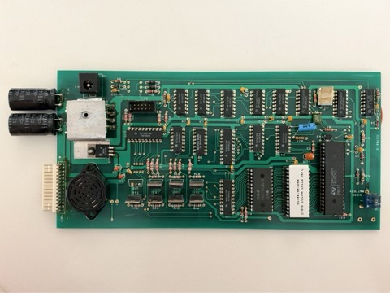](images/3A/cc784-top.jpeg) | [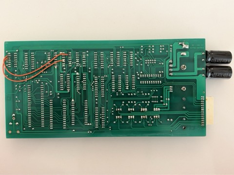](images/3A/cc784-bottom.jpeg) | [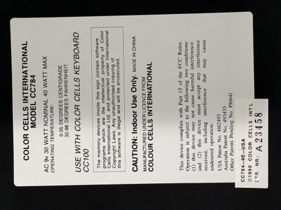](images/3A/cc784-label.jpeg) |

RAM refit ([hardware notes §5, step 1](HARDWARE.md#step-1-ram)):

| | Top | Bottom |
|---|---|---|
| Socket out, with the hole | [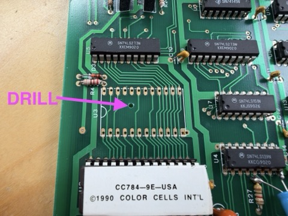](images/3A/cc784-ram-socket-removed-top.jpeg) | [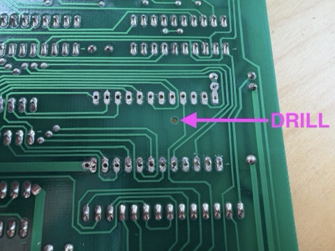](images/3A/cc784-ram-socket-removed-bottom.jpeg) |
| 28-pin socket fitted, with the two cuts | [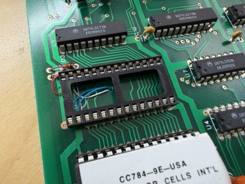](images/3A/cc784-ram-socket-28pin-top.jpeg) | [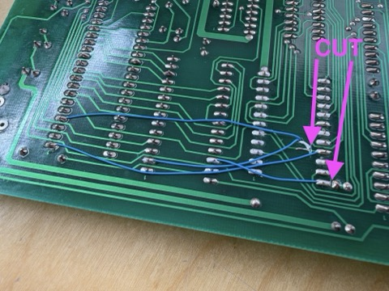](images/3A/cc784-ram-socket-28pin-bottom.jpeg) |

Power-fail lockout ([hardware notes §5, step 2](HARDWARE.md#step-2-power-fail-detect-and-reset)):

| Q9 over U17, its collector wired to U13 pins 9 and 10, and the cut at U13 pin 5 |
|---|
| [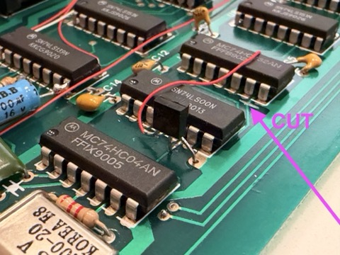](images/3A/cc784-power-fail-q9-top.jpeg) |

### CC710

| | Top | Bottom |
|---|---|---|
| As shipped | [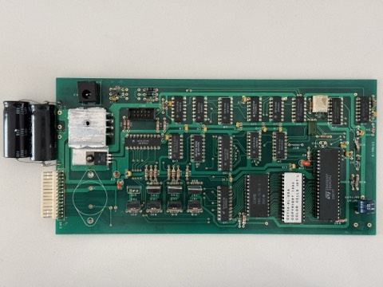](images/3A/cc710-top.jpeg) | [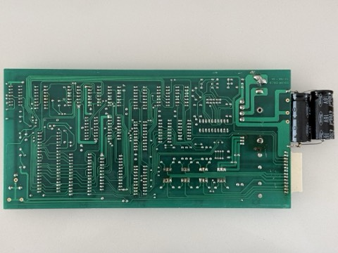](images/3A/cc710-bottom.jpeg) |
| Modified | [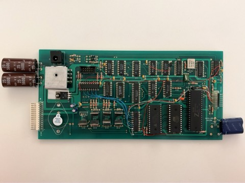](images/3A/cc710-top-reworked.jpeg) | [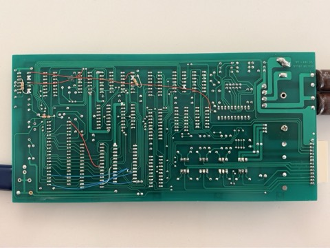](images/3A/cc710-bottom-reworked.jpeg) |

| Rating label |
|---|
| [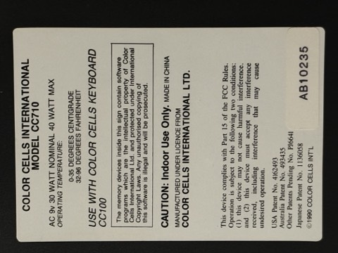](images/3A/cc710-label.jpeg) |

## `CC784-4` boards

### CC784NET

| | Top | Bottom |
|---|---|---|
| As shipped | [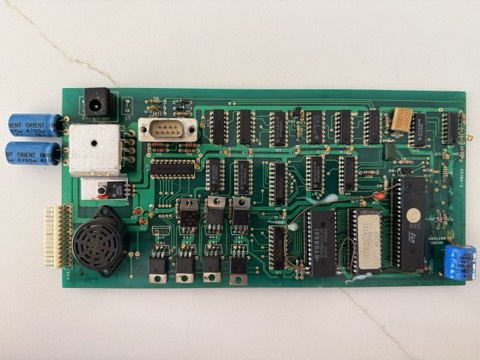](images/4/cc784net-top.jpeg) | [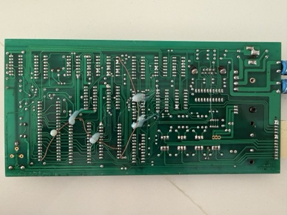](images/4/cc784net-bottom.jpeg) |
| Modified | [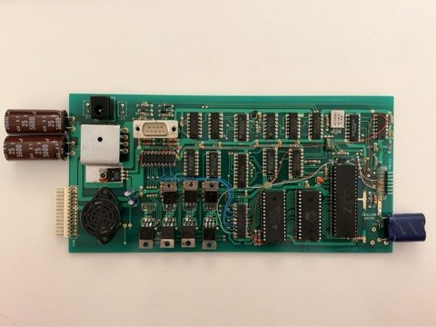](images/4/cc784net-top-reworked.jpeg) | [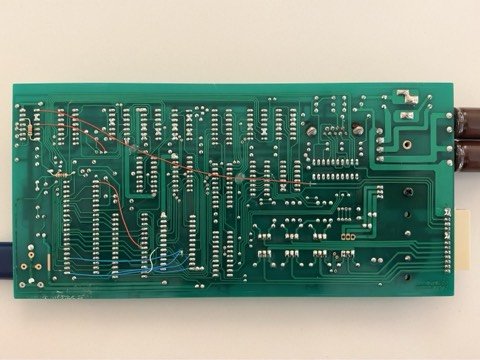](images/4/cc784net-bottom-reworked.jpeg) |

| Rating label |
|---|
| [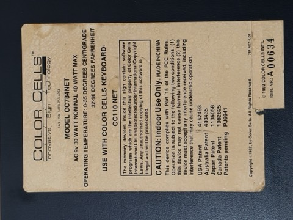](images/4/cc784net-label.jpeg) |

### CC784NIR

| | Top | Bottom |
|---|---|---|
| As shipped | [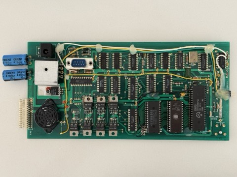](images/4/cc784nir-top.jpeg) | [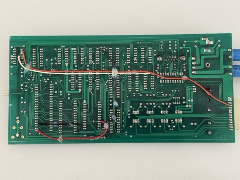](images/4/cc784nir-bottom.jpeg) |
| Modified | [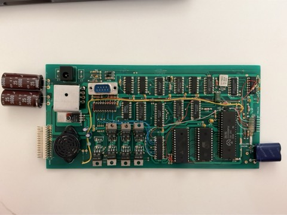](images/4/cc784nir-top-reworked.jpeg) | [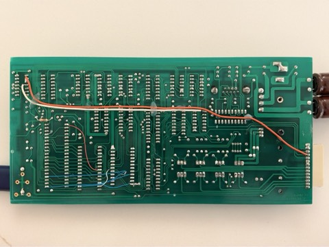](images/4/cc784nir-bottom-reworked.jpeg) |

| Pinouts on the RAM, EPROM and Z80 | Close-up around the DB9: 74LS244, 74LS164, 74LS145 | Rating label |
|---|---|---|
| [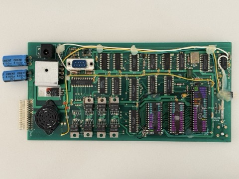](images/4/cc784nir-top-annotated.jpeg) | [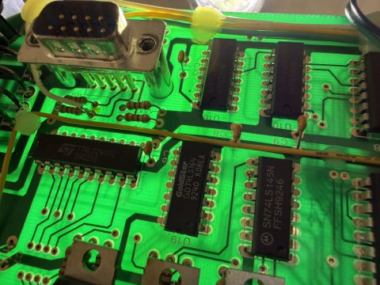](images/4/cc784nir-comms.jpeg) | [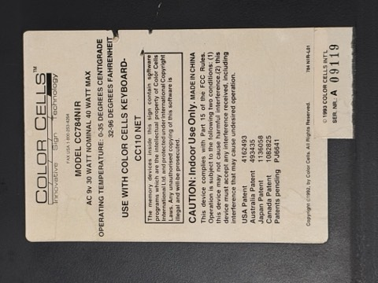](images/4/cc784nir-label.jpeg) |
